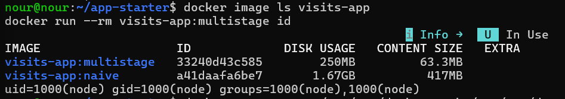
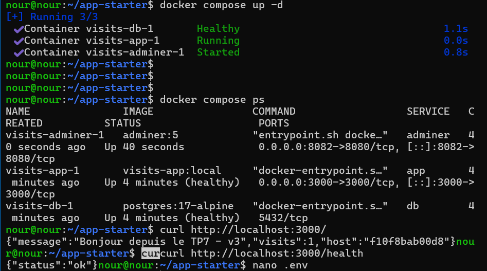
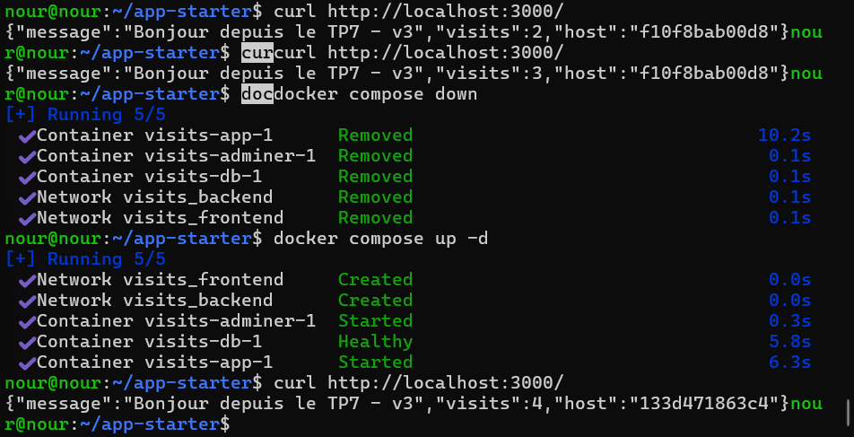
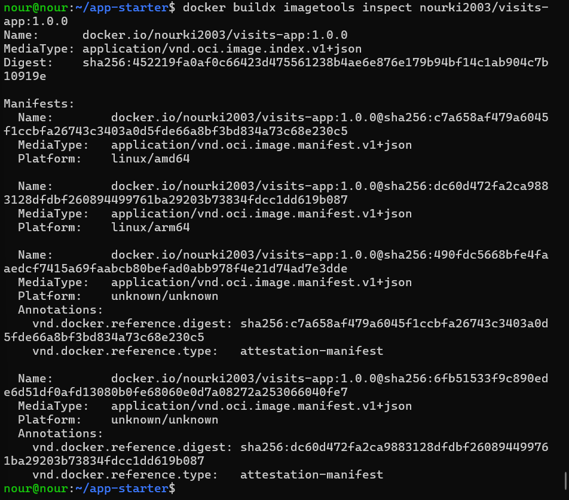
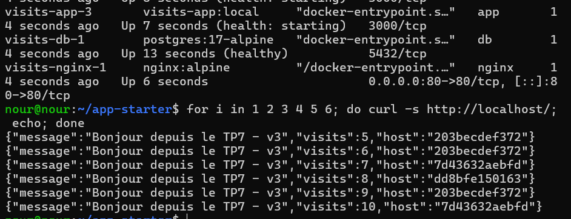

# TP7 : Docker avancé et Docker Compose

Application Node.js/TypeScript (compteur de visites stocké dans PostgreSQL) conteneurisée avec un build multi-stage, un utilisateur non-root et un HEALTHCHECK, puis décrite avec Docker Compose (app, PostgreSQL, Adminer, Nginx) et publiée en image multi-architecture.

## Contenu du dépôt

| Fichier | Rôle |
|---|---|
| `Dockerfile` | Build multi-stage (deps, build, runtime), utilisateur `node`, HEALTHCHECK |
| `Dockerfile.naive` | Dockerfile naïf fourni, point de comparaison |
| `.dockerignore` | Exclut node_modules, dist, .git, .env, etc. |
| `compose.yaml` | Pile app, db, adminer, nginx : réseaux, volume nommé, healthcheck |
| `nginx.conf` | Reverse proxy vers `app` (défi) |
| `.env.example` | Variables attendues (le vrai `.env` n'est pas versionné) |
| `captures/` | Captures d'écran des livrables |

## Partie 1 et 2 : couches, cache et image naïve

Après modification de `server.ts`, `npm install` est rejoué avec le Dockerfile naïf : `COPY . .` précède `npm install`, donc toute modification d'un fichier source invalide cette couche et toutes les suivantes. Dans le Dockerfile multi-stage, seuls `package*.json` sont copiés avant `npm ci` : tant que les dépendances ne changent pas, la couche est réutilisée (CACHED).

## Partie 3 : comparaison naive et multistage

| Indicateur | naive | multistage |
|---|---|---|
| Taille de l'image | 1,67 GB (417 MB de contenu) | 250 MB (63,3 MB de contenu) |
| Temps de build (à froid) | 10,9 s | 27,5 s |
| Temps de build (code modifié) | 13,2 s | 7,1 s (`npm ci` en CACHED) |
| Vulnérabilités HIGH/CRITICAL | 454 HIGH / 20 CRITICAL | 6 HIGH / 0 CRITICAL |
| Utilisateur | root (uid=0) | node (uid=1000) |

Les vulnérabilités ont été comptées avec Trivy (`--severity HIGH,CRITICAL --format json`).

**Lecture des résultats.** À froid, l'image multi-stage est plus lente à construire (trois étapes, aucun cache), ce qui est normal. Son avantage apparaît dès qu'on modifie le code : l'étape `npm ci` est réutilisée depuis le cache alors que le Dockerfile naïf réinstalle toutes les dépendances. Le gain principal est ailleurs : image environ 6,7 fois plus petite, 454 vulnérabilités HIGH réduites à 6, aucune CRITICAL, et processus non-root.




## Partie 4 : pile Docker Compose

Services : `app` (Node.js, réseaux frontend et backend), `db` (PostgreSQL 17, réseau backend uniquement, aucun port publié, volume nommé `pgdata`, healthcheck `pg_isready`) et `adminer` (réseau backend). `app` attend que `db` soit `healthy` grâce à `depends_on` avec `condition: service_healthy`. Les identifiants viennent du fichier `.env`, non versionné.



**Persistance.** Le compteur de visites est conservé après `docker compose down` puis `docker compose up -d`, grâce au volume nommé `pgdata`.



**Que fait `docker compose down -v` ?** Il supprime les conteneurs et les réseaux, mais aussi les volumes nommés : `pgdata` disparaît et le compteur repart de zéro.

**Isolation réseau.** `db` ne publie aucun port : `psql -h localhost` depuis la VM échoue, alors que `app` joint `db` par son nom DNS sur le réseau `backend`.

**Problème du `--scale app=2` avec `ports: "3000:3000"`.** Deux conteneurs ne peuvent pas publier le même port hôte : le second échoue avec un conflit de port. La solution est de ne plus publier `app` et de passer par un reverse proxy.

## Partie 5 : Buildx et image multi-architecture

Image publiée : `nourki2003/visits-app:1.0.0` (linux/amd64 et linux/arm64).



## Défi : reverse proxy Nginx et scale

Nginx est le seul service à publier un port (80) ; `app` est lancée avec `--scale app=3`. Le champ `host` change d'une requête à l'autre : trois conteneurs répondent.



## Lancer le projet

```bash
cp .env.example .env      # puis choisir un mot de passe
docker compose up -d --build
curl http://localhost/
docker compose up -d --scale app=3
```
